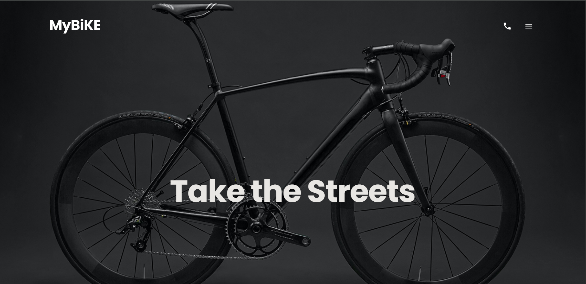

# Bike Landing Page

A responsive landing page for a bike shop, built from a Figma design with semantic HTML and SCSS.

[**Live demo**](https://alucardyagamigame.github.io/bike-landing-page/)



## Features

- Responsive layout for mobile, tablet and desktop
- Mobile burger menu with smooth open/close behavior
- Sections: hero, bike models, about us, details gallery, contacts with a form, footer
- Hover and focus states for links, buttons and cards
- Accessible markup: semantic tags, alt texts, visually hidden labels

## Tech stack

- HTML5
- SCSS (BEM naming, split into `abstract`, `base`, `blocks` and `utils` folders)
- Parcel (via Mate Academy scripts)
- Git and GitHub Pages for deployment

## Getting started

```bash
git clone https://github.com/AlucardYagamiGame/bike-landing-page.git
cd bike-landing-page
npm install
npm start
```

The project will open at `http://localhost:8080`.

Other commands:

- `npm run build` creates a production build in `dist`
- `npm run deploy` publishes the site to GitHub Pages

## Project structure

```
src/
├── images/     # images and icons
├── scripts/    # JavaScript
├── styles/     # SCSS partials (abstract, base, blocks, utils)
└── index.html
```

## Design

[Figma mockup](https://www.figma.com/design/X6ebbciXnbh7txFjKwxWNq/BIKE-New-Version--Copy-?node-id=0-1&p=f&t=LKWV69xFGMbuZPpk-0)
